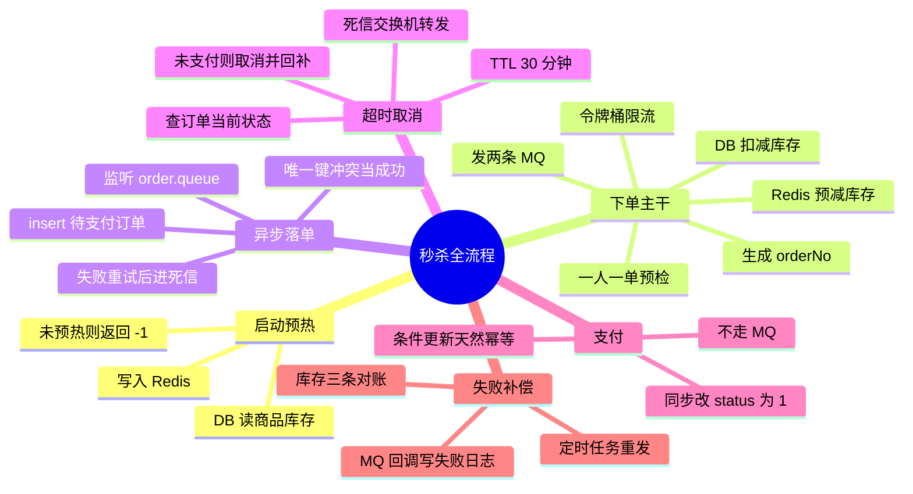

# 秒杀系统全流程导图

> 按当前代码实现整理。可直接把「大纲」部分复制进幕布 / ProcessOn / XMind（缩进即层级），  
> 或把「Mermaid」部分粘进支持 Mermaid 的编辑器（ProcessOn、Typora、Obsidian 均可）。

---

## Mermaid（可视化版）

---

## 大纲（详细版，可导入工具）

- 一、启动预热
  - StockPreheatRunner（CommandLineRunner）
    - 查 DB：`seckill_goods` 全表
    - 写 Redis：`seckill:stock:{goodsId}` = stock
    - 目的：让 STOCK_LUA 能查到库存
    - 未预热后果：Lua 读到 nil → 返回 -1 → 前端提示"商品不存在"
- 二、下单主干（`POST /api/seckill/redis`）
  - - key：`seckill:limit:all`
    - Lua 原子操作：读 tokens → 按 Redis TIME 补令牌 → 扣 1
    - 不通过 → 429「请求过于频繁」
    - 为什么用 Lua：读-算-写三步，Java 侧会并发穿透
  - - `selectByUserAndGoods(userId, goodsId)`
    - 已存在 → 400「每人限购一件」
    - 只是预检，最终靠 `uk_order_no` 唯一索引兜底
  - - `GET seckill:stock:{goodsId}`
    - nil → 返回 -1（商品不存在 / 未预热）
    - stock < 1 → 返回 0（已售罄）
    - 否则 `DECRBY 1` → 返回 1
    - 意义：在 Redis 这层挡掉 99% 的无效流量，不打到 DB
  - - `UPDATE seckill_goods SET stock = stock - 1 WHERE id = ? AND stock > 0`
    - rows == 0 → 400「库存不足」
    - 意义：`AND stock > 0` 是最后一道防超卖
  - - UUID 去掉横线
    - 消息体格式：`userId:goodsId:orderNo`
  - - a) 默认交换机 → `seckill.order.queue`（去异步落单）
    - b) `seckill.delay.exchange` → 延迟队列（30 分钟后检查是否支付）
    - 都用 CorrelationData 贴身份，供 confirm 回调识别
  - - `SeckillResult(orderNo, "抢购成功，订单处理中")`
    - 注意：此时订单还**没有**落库，只存在于 MQ 里
- 三、异步落单（OrderConsumer）
  - 监听 `seckill.order.queue`
  - 解析 `userId:goodsId:orderNo`
  - INSERT `seckill_order`，status = 0（待支付）
  - 唯一键冲突（DuplicateKeyException）
    - 说明这条订单已经落过库了
    - 当「消费成功」处理，直接 return，让框架 ack
    - 若当失败抛出 → 重试 3 次全撞唯一键 → 污染 DLQ
  - 真失败 → 重试 3 次（1s / 2s / 4s 指数退避）
    - 仍失败 → `seckill.dlx` → `seckill.order.dlq`
- 四、超时取消（延迟队列方案）
  - 消息进 `seckill.order.delay.queue`
    - TTL = 30 分钟（`x-message-ttl`）
    - **这个队列没有消费者**，就是用来"搁置"消息的
  - TTL 到期 → 变死信
    - → `seckill.dlx`（`x-dead-letter-exchange`）
    - routingKey = `seckill.order.timeout.routingkey`
  - → `seckill.order.timeout.queue`（有消费者）
  - OrderTimeoutConsumer 处理
    -
    - - 必须查：消息是 30 分钟前发的，这期间用户可能已付款
    -
    -
    - - SQL 带 `WHERE status = 0`
      - rows == 0 → 状态已变（刚付款），不回补库存
      - rows > 0 → `addStock`（DB）+ `addStockToRedis`（Redis）
    - - → 重试 3 次 → 仍失败 → 死信队列
  - 为什么要同时补 Redis
    - 下单时是 Redis 先扣的
    - 只补 DB 会变成「Redis = 0 售罄，DB 还有 1」→ 后续请求全被 Lua 拦下 → 少卖
- 五、支付（`POST /api/seckill/pay`）
  - `payOrder(orderNo)` → `makePaid(orderNo)`
  - `UPDATE seckill_order SET status = 1 WHERE order_no = ? AND status = 0`
  - **不走 MQ**，同步一条 SQL 完成
  - 幂等来自 `AND status = 0`
    - 重复支付：第二次 rows = 0
    - 已取消订单：也改不动
  - 和延迟队列的关系
    - 支付 = 随时来**写** status
    - 延迟队列 = 30 分钟后**读** status
    - 一个写一个读，作用在同一个字段上
- 六、失败补偿与兜底
  - MQ 可靠性
    - MqConfirmCallback：消息到没到交换机
    - MqReturnsCallback：路由不到队列时回调
    - 失败写 `mq_fail_log` 表
    - MqFailRetryTask：定时扫表重发
  - 库存对账（StockReconcileTask，每 60 秒）
    - A：DB 侧 `stock + occupied == initial_stock`
    - B：Redis 侧 `redisStock + occupied == initial_stock`
    - C：`redisStock == stock`（两边一致）
    - 三条独立 if，一次暴露全部问题
    - 5 分钟内有订单则跳过（在途窗口：Lua 扣了但订单还没落库）
    - 只读报警，不自动修复
- 七、对照实验（同一逻辑的三个版本）
  - `/api/seckill/redis`（主版本）
    - 带 `@Transactional`
    - DB 扣减 + 发 MQ 在同一个事务里
  - `/api/seckill/redis/v2`（压测对照）
    - 无事务，DB 扣减后立刻释放行锁
    - MQ 在锁外发送，吞吐更高
    - 代价：发 MQ 失败要手动回补 DB + Redis
  - `/api/seckill/do`（早期版本）
    - 同步 insert 订单，没有 MQ 削峰
    - 保留作为演进对比

---

## 三条主线的读法

| 线       | 起点        | 终点          | 回答什么问题       |
| ------- | --------- | ----------- | ------------ |
| **主干**  | 用户点击      | 返回 orderNo  | 一次抢购，系统状态怎么变 |
| **超时线** | 30 分钟前的消息 | 订单取消 + 库存回补 | 用户不付款会怎样     |
| **兜底线** | 定时任务触发    | 报警 / 重发     | 中间件出问题时靠什么发现 |

三条线共用同一个核心对象：`seckill_order.status`（0 待支付 / 1 已支付 / 2 已取消）。  
主干创建它，支付改写它，超时线检查它，兜底线核对它。

